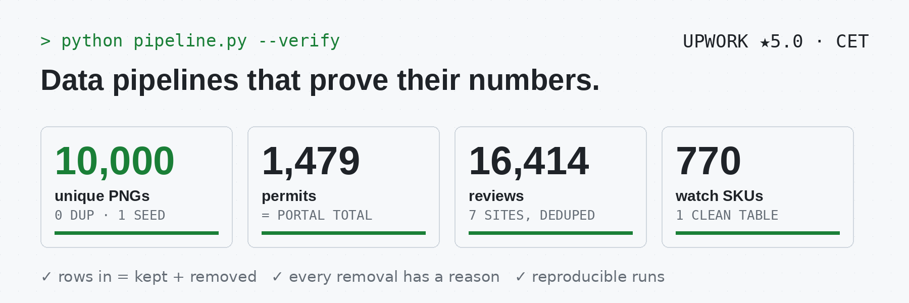

<picture>
  <source media="(prefers-color-scheme: dark)" srcset="banner_dark.png">
  
</picture>

Scrapers and data pipelines in Python where every run ends with a count that has to add up. Open to freelance work.

`Python` `pandas` `Playwright` `requests` `PostgreSQL` `Google Sheets` `Apps Script` `Excel`
